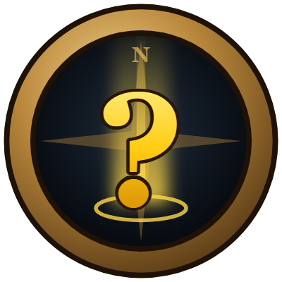
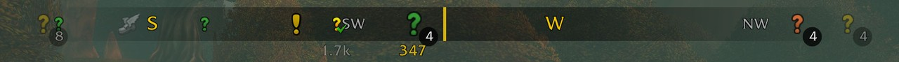
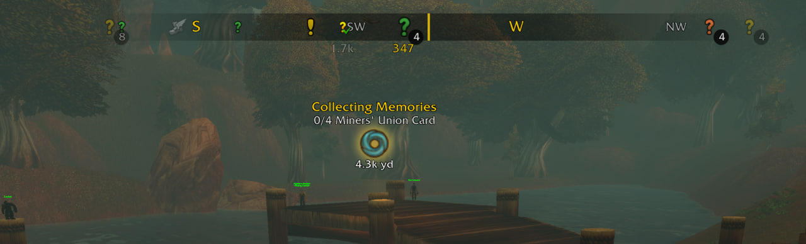
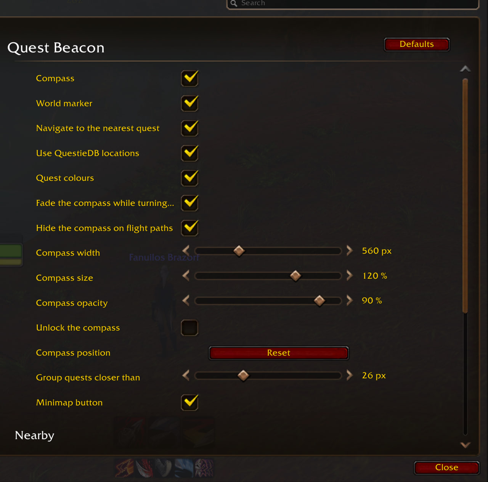

# Quest Beacon

**Every tracked quest on a compass bar. The nearest one marked in the world.**

A WoW: Forever addon. No more opening the map to see where to go next.

## Features

- **Compass bar**: a pin for every tracked quest at its real direction, with the distance. Turns with your character.
- **World marker**: stands on the quest you're heading to, with its name, next objective and distance. Replaces the game's diamond.
- **Nearest first**: navigation switches to the closest quest as you move. Pick one yourself and it sticks until it's done.
- **Click to go**: click a pin to navigate there. Right-click to skip that quest and go to the next nearest.
- **Grouping**: quests close together share one pin with a count. Hover for the list, nearest first.
- **Tells quests apart at a glance**: yellow "?" ready to turn in, dungeon and raid icons, coloured by level from grey to red like the quest log (can be turned off).
- **What's nearby**: flight masters, and quest givers with a quest you can take (with QuestieDB), show on the compass when they're close, each kind within its own range. A new one pulses as it comes into range, even behind you. Undiscovered flight masters stand out, known ones are greyed.
- **Your own pins**: the map pin you place (Ctrl+click on the map) is on the compass and never replaced; navigation goes there until you reach or remove it. Notes you add with HandyNotes show too.
- **Stays out of the way**: fades while you swing the camera, hides on flight paths, sits under the rest of the UI.
- **Your layout**: move it anywhere, top or bottom, and set its size, width and opacity. Distances and tooltips flip above the bar at the bottom of the screen.

## Better with QuestieDB

Install [QuestieDB](https://github.com/Questie/QuestieDB) and pins point at the nearest mob, object or NPC the quest actually needs, not just the game's quest area. It also shows the quest givers near you with a quest you can take.

## Works with

- QuestieDB (optional, better locations and quest givers)
- HandyNotes (optional, your own notes on the compass)
- Leatrix Plus and other minimap button collectors
- QuestMaster: also picks the navigated quest, so turn off one of the two world markers

## Setup

Nothing to set up. To change things: `/qb`, the minimap button, or Options → AddOns → Quest Beacon.

| Command | |
|---|---|
| `/qb` | settings |
| `/qb next` | next quest by distance (also a key binding) |
| `/qb move` | unlock the compass to drag it (also in the settings) |
| `/qb compass` / `marker` / `auto` | toggle compass, world marker, nearest first |
| `/qb why` | where each quest is believed to be |

## Good to know

The game lets addons place only one point in the 3D world, so only one quest gets a world marker at a time. The compass covers the rest.

## Download

[CurseForge](https://www.curseforge.com/wow/addons/quest-beacon) · [GitHub releases](https://github.com/f4nu/quest-beacon/releases)

## Bugs and ideas

[GitHub issues](https://github.com/f4nu/quest-beacon/issues)
